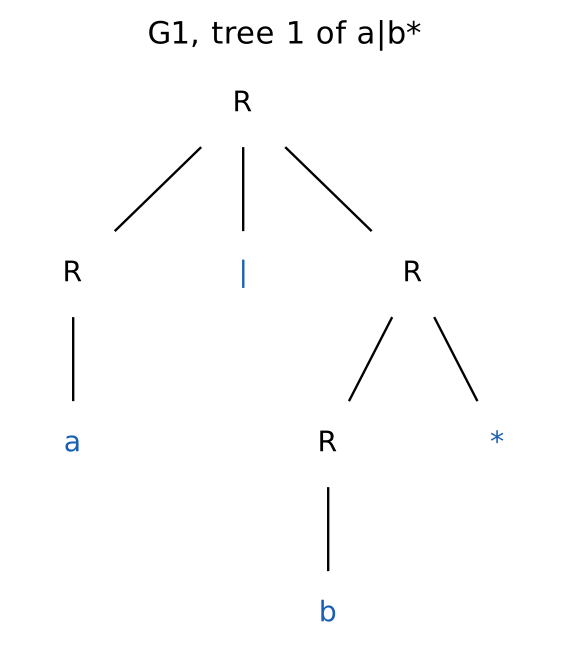
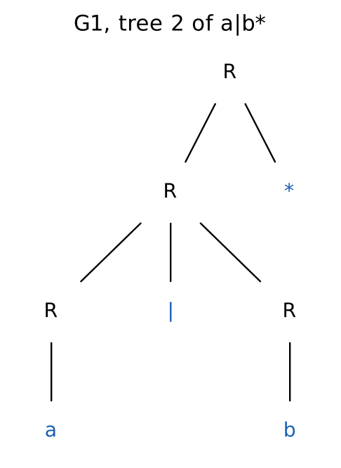
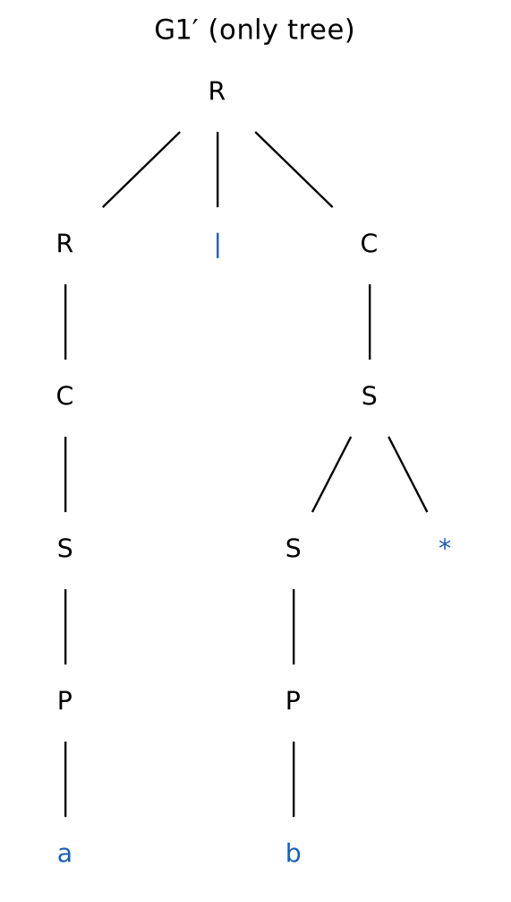
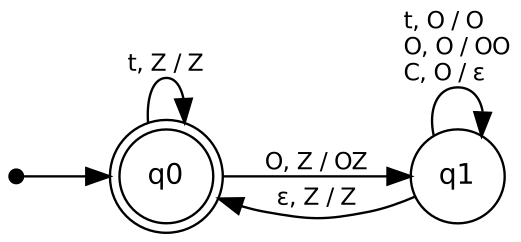
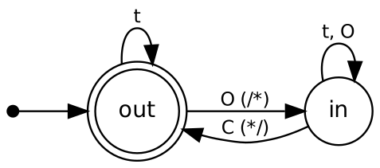
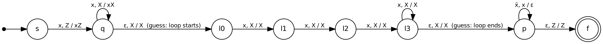
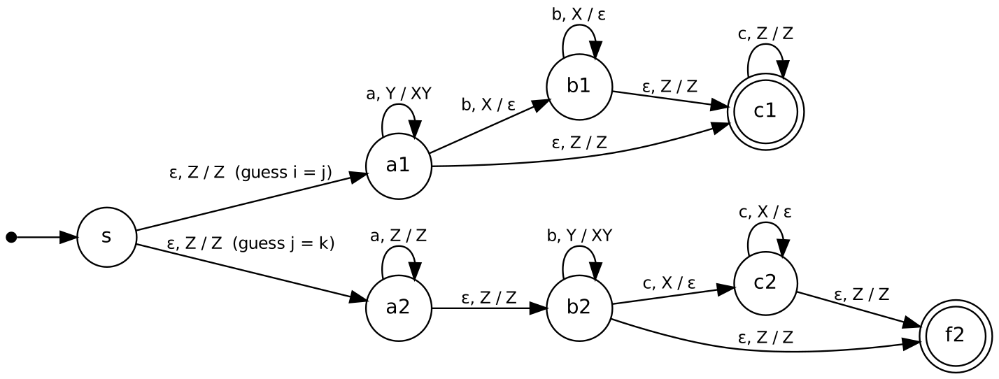

# PDA and CFG Case Studies: Regex Syntax, Nested Comments, RNA Hairpins, Inherent Ambiguity

**Course:** 21CSC301T Formal Language and Automata, CLA-2, Assessment Task 3
**Student:** Joshua Pope (RA2411026050273), jp2155@srmist.edu.in
**Faculty:** Dr. C. Gunasundari, Assistant Professor, Department of AIML, SRM IST Tiruchirappalli

| # | Case study | Ambiguous grammar → fix | PDA | Deterministic? |
|---|---|---|---|---|
| 1 | Regular-expression syntax (`a\|b*`, `(a\|b)*abb`) | one-level grammar → levels R, C, S, P (`*` > concatenation > `\|`) | CFG → PDA, LL(1) parser | general PDA no, LL(1) yes |
| 2 | Nested block comments `/* /* */ */` (Rust, Swift, Haskell) | `P → P P …` → `P → X P \| ε` | 2-state DPDA; C-style comments need only a 2-state DFA | yes |
| 3 | RNA hairpin (stem-loop) | every stem length is a tree → "maximal stem" grammar | NPDA guessing where the loop starts and ends | no |
| 4 | aⁱbʲcᵏ with i = j or j = k | ambiguous on aⁿbⁿcⁿ — **inherently**, no fix exists | NPDA guessing the branch | no |

## Run it

```bash
pip install pytest
python -m pda_cases.cli all            # everything, with derivations and stack moves
python -m pda_cases.cli regex          # or: comments | rna | ijk | ambiguity
python -m pytest -q                    # 27 checks
python tools/make_diagrams.py          # rebuild diagrams (Graphviz)
```

## 1. Regular-expression syntax

The notation of this course is itself a context-free language. **G1:**
`R → R | R | R R | R * | ( R ) | a | b`. The string `a|b*` has two trees, and they describe
**different languages**: a|(b*) does not contain `ab`, while (a|b)* does. Likewise `ab*` is
a(b*) or (ab)*, and `a|ba` is a|(ba) or (a|b)a.

| tree 1: a\|(b*) | tree 2: (a\|b)* | G1′ |
|---|---|---|
|  |  |  |

**G1′:** `R → R | C | C`, `C → C S | S`, `S → S * | P`, `P → ( R ) | a | b` encodes the
standard precedence. The tests check, for 300 random regexes, that the single G1′ tree means
exactly what Python's `re` module means. The CFG → PDA construction explores 120 configurations
on `a|b*`; the left-recursion-free G1″ has an LL(1) table with 0 conflicts (G1: 3, G1′: 9) and
parses `a|b*` in 19 steps.

## 2. Nested block comments

Tokens: `O` = `/*`, `C` = `*/`, `t` = other text. **C-style** comments do not nest — the first
`*/` closes — so a 2-state DFA (out/in) is enough. **Nested** comments (Rust, Swift, Haskell
`{- -}`) need a count of open comments, which is not regular (pumping lemma on Oᵖ Cᵖ).

| DPDA M2 for nested comments | DFA for C-style comments |
|---|---|
|  |  |

The same source line gets different verdicts: `/* outer /* inner */ still outer */ run();` is
fine with nesting and an error in C; `/* outer /* inner */ forgot outer` is the reverse.
**G2:** `P → P P | O P C | O C | t` (tᵏ has Catalan(k−1) trees) is fixed by
**G2′:** `P → X P | ε`, `X → t | O P C`.

## 3. RNA hairpin (stem-loop)

An RNA strand folds back on itself: the 5′ stem pairs with the reverse complement at the 3′ end
(a–u, g–c) around a loop of at least 3 bases. **G3** derives one tree per possible stem length,
so `gcuuuugc` has 2 foldings and `ggacuucggucc` has 4 — here ambiguity is *biology*:
alternative structures that folding algorithms choose between by free energy. **G3′** keeps
the stem as long as possible while the loop keeps ≥ 3 bases (a loop longer than 4 may not start
and end with a pair), giving one tree per hairpin.



The NPDA pushes the stem, **guesses** where the loop starts, reads ≥ 3 loop bases, **guesses**
where it ends and pops complementary bases (x̄ = partner of x). Like w wᴿ, there is no marker,
so no DPDA can do this.

## 4. aⁱbʲcᵏ with i = j or j = k

`S → X C | A Y` with `X → aXb | ε`, `C → cC | ε`, `A → aA | ε`, `Y → bYc | ε`. Every aⁿbⁿcⁿ
satisfies **both** conditions and has exactly 2 trees; every other string at most 1. This
language is **inherently ambiguous** (Hopcroft–Motwani–Ullman, via Ogden's lemma): *no* CFG for
it is unambiguous, so the assignment's "suggest a revised grammar" step has no answer here — the
practical fix is a stated priority (take the i = j reading first), exactly as parser generators
resolve conflicts. The NPDA guesses the branch at the start and has 2 accepting runs on aⁿbⁿcⁿ.



## Bounded ambiguity check

`python -m pda_cases.cli ambiguity`: G1 is ambiguous on 1 804 of 2 092 regexes (≤ 6 tokens),
G2 on 419 of 538 comment strings, G3 on 5 120 of 21 760 sequences, G4 on 4 of 56 strings
(exactly aⁿbⁿcⁿ, n ≤ 3); every revised grammar gives one tree each.

## Tests (27)

All 55 987 regex token strings up to length 6 (G1, G1′, G1″, LL(1) parser); 300 random regexes
against Python's `re`; all 88 573 comment token strings up to length 10 against a depth counter;
all 21 845 RNA sequences up to length 7 against a brute-force stem search (and the number of
trees against the number of foldings); all 29 524 strings up to length 9 for aⁱbʲcᵏ; pumping
argument for Oᵖ Cᵖ with p ≤ 8.

## Layout

```
pda_cases/grammar.py   CFG, parse-tree counting, derivations, ambiguity check
pda_cases/pda.py       PDA simulator, determinism check, CFG → PDA construction
pda_cases/ll1.py       FIRST/FOLLOW, LL(1) table, predictive parser
pda_cases/cases.py     the four case studies
pda_cases/cli.py       terminal demo
tests/                 27 checks
tools/, docs/diagrams/ diagram generator and output
```
